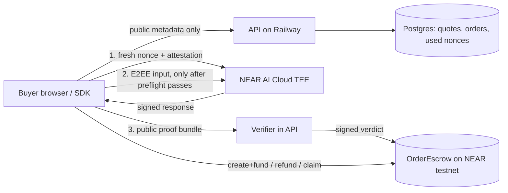

# Architecture

- **Product → Offer → Quote → Order → Receipt**, product `private_ai_inference.v1`.
- Offers are a static registry merged with the live NEAR AI Cloud model catalog. `demo-outage-simulator` is a labelled demo configuration.
- Quote binds `{jobId, offer, model, buyer, provider, maxPay, deadline, contract}` into `quote_digest`, stored on-chain.
- `POST /v1/orders` re-reads the contract and only indexes an order that is Funded and matches the quote. The contract is the source of truth for status.
- `POST /v1/orders/:id/proof` accepts only the allow-listed `ProofBundle` shape (attestations + signature, no text fields).
- Deadline/refund path works with the API offline: the buyer calls `request_refund` on the contract.

See `docs/security-model.md` and `docs/proof-format.md`.
